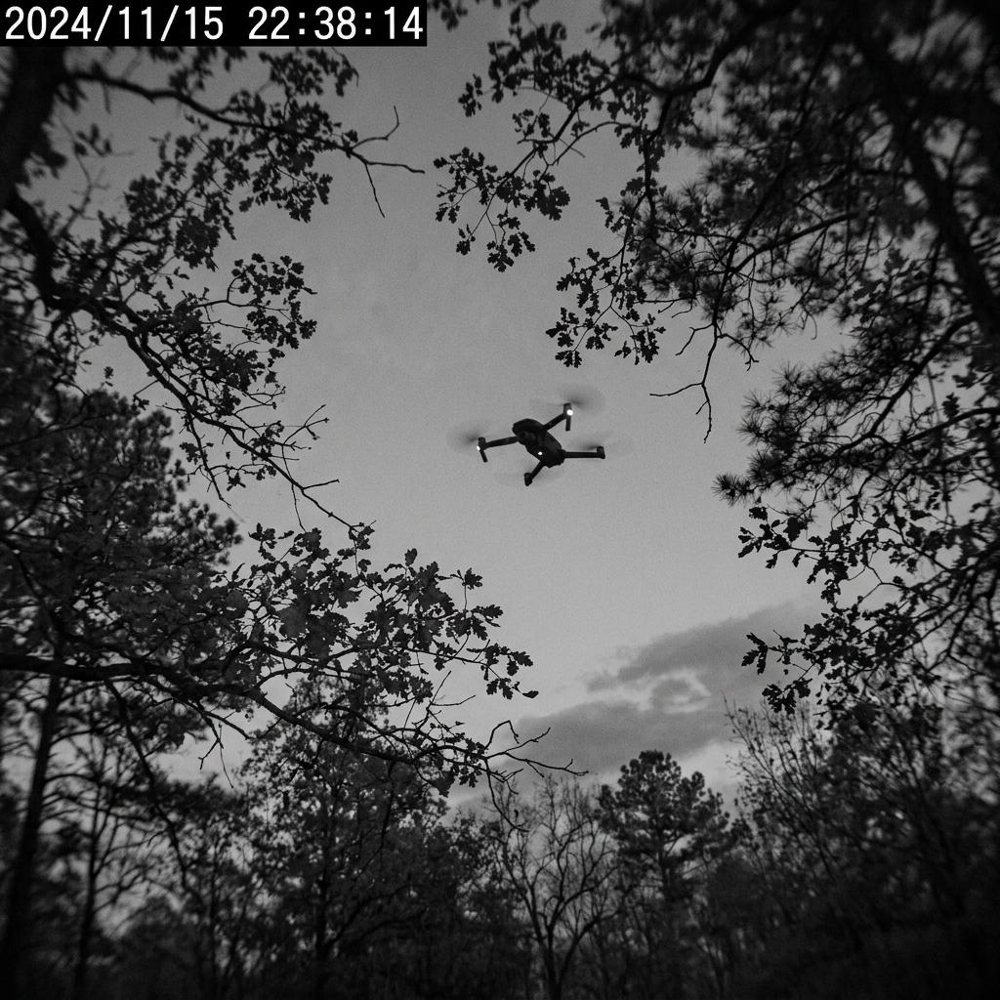

# 🌍 Eco-Acoustic Mesh Sentinel Network

> **A low-bandwidth, Edge-AI powered wildlife security and monitoring platform.**

The Eco-Acoustic Mesh Sentinel Network is designed to protect vast, remote wildlife reserves by deploying low-cost, Edge-AI acoustic and vision sensor nodes. These nodes process data locally in the wild and transmit tiny, 20-byte threat alerts over long-range LoRa radio to a central Ranger Dashboard.

 *(Simulated UI Intercept)*

## 🚀 The Problem We Solve
Traditional wildlife monitoring relies on high-bandwidth camera traps that require 4G/LTE or manual retrieval. In remote African savannas or dense rainforests, cellular connectivity is non-existent. 

**Our Solution:** Move the AI to the edge. Our nodes use embedded Machine Learning (YOLOv8 & Audio classification) to detect **Poachers**, **Gunshots**, **Chainsaws**, and **Suspicious Vehicles**. Instead of sending megabytes of video, the node transmits a highly optimized **20-byte binary payload** over LoRa (Long Range) radio, covering distances up to 15km without internet!

## 🌟 Key Features

### 📡 Low-Bandwidth LoRa Protocol
Custom binary payload structure designed for extreme efficiency.
- Packets contain: Protocol Version, Node ID, Threat Code, Confidence %, GPS Location, Battery level, and CPU temp.
- Total size: **20 bytes** (Decoding built in C++ firmware and Python Gateway).

### 🖥️ Real-Time Ranger Dashboard (PWA)
- **Live SSE Streaming:** Alerts stream instantly from the FastAPI gateway to the Leaflet.js mapping interface.
- **Contextual Awareness:** Plots threats with severity colors, confidence radii, and pulsing animations.
- **Edge-AI Visual Verification:** "Intercepts" local edge-camera footage when a poacher is detected, displaying high-res visual evidence in the map overlay.

### 🧠 Edge AI Capabilities (Ready for Deployment)
- **Acoustic:** Listens for non-natural anomalies (Gunshots, Axes, Dog Barks).
- **Vision:** Ready for ESP32-CAM or Raspberry Pi deployments. Uses a YOLOv8 Nano model to identify human silhouettes and vehicles locally.
- *Bonus:* Includes `roboflow_hosted_node.py` to seamlessly bridge Roboflow Workflows into the LoRa gateway!

## 🛠️ Tech Stack
- **Backend/Gateway:** Python, FastAPI, Server-Sent Events (SSE), SQLite
- **Frontend Dashboard:** Vanilla JS, CSS3 (Glassmorphism), HTML5, Leaflet.js
- **Machine Learning (Simulation):** Ultralytics YOLOv8, Roboflow Hosted API
- **Testing:** `pytest` (100% payload & buffer coverage)

## 💻 Getting Started (Local Simulation)

1. **Clone the Repository**
2. **Install Dependencies:**
   ```bash
   pip install fastapi uvicorn sqlite3
   ```
3. **Start the Gateway & Dashboard Server:**
   ```bash
   python -m gateway.server
   ```
   *The dashboard will be live at `http://localhost:8000`*
4. **Run the Threat Simulation:**
   ```bash
   python scripts/simulate.py --gateway http://localhost:8000 --cycles 50
   ```
5. **(Optional) Run Live Edge AI Node:**
   Ensure you have `ultralytics` installed, and run:
   ```bash
   python edge_camera_node.py
   ```

## 🏆 Hackathon Submission Notes
This project demonstrates a fully functional software architecture ready for hardware integration. The UI, API bridge, data protocols, and ML pipelines are complete.

---
*Built with ❤️ for wildlife conservation.*
